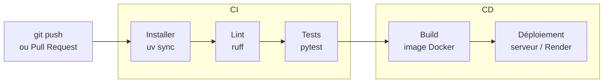

# 1. Principe de la CI/CD

## Définitions

| Sigle | Nom | Question à laquelle il répond | Exemple |
|-------|-----|-------------------------------|---------|
| **CI** | Intégration continue | « Mon code marche-t-il toujours ? » | Lancer lint + tests à chaque push |
| **CD** (livraison) | Continuous Delivery | « Puis-je livrer à tout moment ? » | Construire l'image Docker, prête à déployer |
| **CD** (déploiement) | Continuous Deployment | « Est-ce en ligne automatiquement ? » | Déployer sur le serveur si tout est vert |

> Idée : un **robot** refait pour toi, à chaque changement, ce que tu ferais à la main (installer, tester, construire, déployer).

## Le pipeline

Si **une étape échoue**, le pipeline s'arrête (✗ rouge) : le code cassé n'est pas livré.

## Pourquoi ?

| Sans CI/CD | Avec CI/CD |
|------------|------------|
| « Ça marche sur ma machine » | Même environnement propre à chaque fois |
| Bugs découverts tard | Bugs détectés dès le push |
| Déploiement manuel, risque d'oubli | Déploiement reproductible |
| Revue de code difficile | La PR affiche ✓ ou ✗ |

## Comment ça tourne ?

1. Tu pousses du code (ou ouvres une Pull Request) sur GitHub.
2. GitHub lit un fichier de configuration (un *workflow*) dans le repo.
3. Un **runner** (machine virtuelle temporaire) exécute les étapes.
4. Le résultat (✓ / ✗) apparaît sur la PR et dans l'onglet **Actions**.

## Lien avec les branches

| Événement | Action typique |
|-----------|----------------|
| Pull Request vers `main` | CI seulement (lint + tests) |
| Push / merge sur `main` | CI + build + déploiement |
| Branche `feat/*` | CI seulement |

Voir [learn-git/03-branches.md](../learn-git/03-branches.md).

## Selon la plateforme

| Plateforme | Outil CI/CD | Fichier |
|------------|-------------|---------|
| GitHub | GitHub Actions | `.github/workflows/*.yml` |
| GitLab | GitLab CI | `.gitlab-ci.yml` |
| Forgejo | Forgejo Actions (proche de GitHub) | `.forgejo/workflows/*.yml` |

Ce guide détaille **GitHub Actions** (pages 2-3) puis **GitLab CI** ([page 4](04-gitlab-ci.md)), le plus répandu en entreprise.
