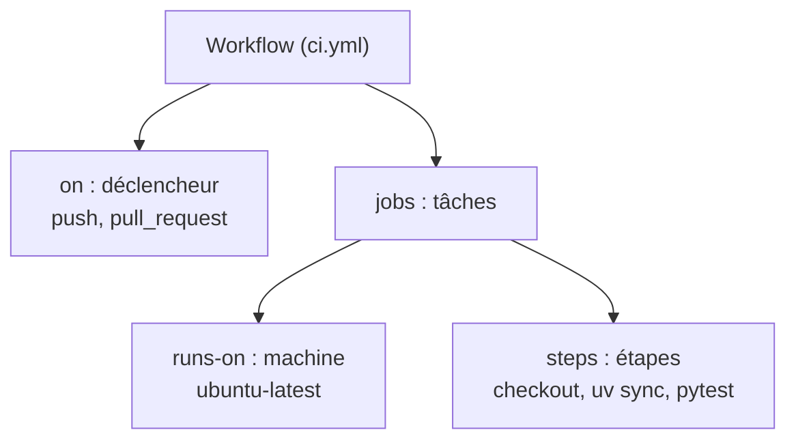

# 2. Les fichiers à ajouter et leur rôle

## Vue d'ensemble (projet type de ce repo)

```text
mon-projet/
├── .github/
│   └── workflows/
│       ├── ci.yml          # CI : lint + tests
│       └── cd.yml          # CD : build image + déploiement
├── tests/
│   └── test_app.py         # tests exécutés par la CI
├── pyproject.toml          # dépendances + config ruff / pytest
├── uv.lock                 # versions figées (reproductible)
├── .python-version         # version de Python
├── Dockerfile              # recette de l'image
├── .dockerignore           # fichiers exclus de l'image
└── .gitignore              # fichiers non versionnés (.env, .venv, *.pkl)
```

## Rôle de chaque fichier

| Fichier | Rôle | Obligatoire pour la CI/CD ? |
|---------|------|-----------------------------|
| `.github/workflows/ci.yml` | **Le pipeline CI** : quand et quoi lancer (install, lint, tests) | ✅ |
| `.github/workflows/cd.yml` | **Le pipeline CD** : construire l'image, la publier, déployer | Pour la livraison |
| `tests/` | Les tests que le robot exécute (`pytest`) | ✅ (sans tests, la CI ne vérifie presque rien) |
| `pyproject.toml` | Dépendances, groupe `dev` (pytest, ruff), réglages des outils | ✅ |
| `uv.lock` | Mêmes versions partout : poste, CI, Docker | ✅ (à commiter) |
| `.python-version` | Python identique en local et en CI | Recommandé |
| `Dockerfile` | Construit l'image à déployer | Pour la CD |
| `.dockerignore` | Allège l'image, évite d'y embarquer `.venv` ou des secrets | Recommandé |
| `.gitignore` | Garde les secrets et fichiers générés hors du dépôt | ✅ |

## Les secrets : jamais dans le code

Les mots de passe et tokens (registre Docker, clé de déploiement…) se stockent dans
**GitHub → Settings → Secrets and variables → Actions**, puis se lisent dans le workflow :

```yaml
password: ${{ secrets.DOCKERHUB_TOKEN }}
```

| ✅ À faire | ❌ À éviter |
|-----------|------------|
| Secrets dans les *Secrets* GitHub | Token écrit dans `ci.yml` ou `.env` commité |
| Un workflow = un objectif (CI / CD) | Un énorme fichier qui fait tout |
| Pipeline rapide (< 5 min) | Étapes inutiles ou lentes |
| Bloquer le merge si la CI est rouge | Merger malgré un ✗ |

## Anatomie d'un workflow



| Mot-clé | Signification |
|---------|---------------|
| `on` | Ce qui déclenche le workflow |
| `jobs` | Blocs de travail (peuvent tourner en parallèle) |
| `runs-on` | Type de machine (runner) |
| `steps` | Liste ordonnée d'étapes |
| `uses` | Réutilise une action toute faite |
| `run` | Exécute une commande shell |
