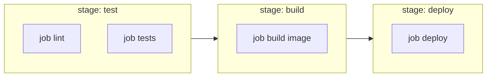

# 4. GitLab CI/CD (le plus courant en entreprise)

Même idée que GitHub Actions, mais la configuration tient dans **un seul fichier à la racine** : `.gitlab-ci.yml`.

## GitHub Actions vs GitLab CI

| | GitHub Actions | GitLab CI |
|---|---|---|
| Fichier | `.github/workflows/*.yml` (plusieurs) | `.gitlab-ci.yml` (un seul, racine) |
| Unité de base | `jobs` + `steps` | `jobs` rangés dans des `stages` |
| Briques réutilisables | `uses:` (actions du marketplace) | `include:` + `extends:` + templates |
| Déclencheur | `on:` | `rules:` (par job) |
| Machine | `runs-on:` | `image:` (conteneur) + **runner** |
| Secrets | Secrets du repo | **CI/CD Variables** (masquées / protégées) |
| Registre Docker | À configurer (Docker Hub…) | **Container Registry intégré** |
| Vocabulaire | Pull Request | **Merge Request (MR)** |

## Les concepts clés



- Les **stages** s'exécutent dans l'ordre ; les **jobs d'un même stage tournent en parallèle**.
- Si un job échoue, les stages suivants ne démarrent pas.

| Mot-clé | Rôle |
|---------|------|
| `stages` | Liste ordonnée des étapes |
| `image` | Image Docker dans laquelle le job s'exécute |
| `script` | Commandes du job |
| `before_script` | Commandes avant `script` (préparation, login) |
| `rules` | Quand lancer le job (branche, MR, tag…) |
| `variables` | Variables d'environnement du pipeline |
| `cache` | Garde des fichiers entre pipelines (dépendances → plus rapide) |
| `artifacts` | Fichiers produits, passés aux jobs suivants (rapports, build) |
| `needs` | Lancer un job dès qu'un autre est fini, sans attendre le stage |
| `environment` | Cible de déploiement (staging, production) suivie dans GitLab |
| `when: manual` | Job déclenché à la main (bouton ▶), typique pour la prod |
| `include` / `extends` | Réutiliser des morceaux de config (évite la répétition) |
| `services` | Conteneurs annexes (ex : `docker:dind`, base de données) |

## Exemple minimal : `.gitlab-ci.yml`

```yaml
stages: [test, build, deploy]

default:
  image: ghcr.io/astral-sh/uv:python3.12-bookworm

variables:
  UV_CACHE_DIR: .uv-cache

cache:
  key:
    files: [MLOps/model-deployment/uv.lock]
  paths: [.uv-cache]

# Modèle réutilisable : lancer sur les Merge Requests et sur la branche par défaut
.on-mr-or-main:
  rules:
    - if: $CI_PIPELINE_SOURCE == "merge_request_event"
    - if: $CI_COMMIT_BRANCH == $CI_DEFAULT_BRANCH

lint:
  extends: .on-mr-or-main
  stage: test
  script:
    - cd MLOps/model-deployment
    - uv sync --frozen
    - uv run ruff check .

tests:
  extends: .on-mr-or-main
  stage: test
  script:
    - cd MLOps/model-deployment
    - uv sync --frozen
    - uv run pytest

build-image:
  stage: build
  image: docker:27
  services: [docker:27-dind]
  rules:
    - if: $CI_COMMIT_BRANCH == $CI_DEFAULT_BRANCH
  before_script:
    - echo "$CI_REGISTRY_PASSWORD" | docker login -u "$CI_REGISTRY_USER" --password-stdin "$CI_REGISTRY"
  script:
    - docker build -t "$CI_REGISTRY_IMAGE:$CI_COMMIT_SHORT_SHA" MLOps/model-deployment
    - docker push "$CI_REGISTRY_IMAGE:$CI_COMMIT_SHORT_SHA"

deploy-prod:
  stage: deploy
  rules:
    - if: $CI_COMMIT_BRANCH == $CI_DEFAULT_BRANCH
      when: manual            # bouton ▶ : déploiement validé par un humain
  environment: production
  script:
    - echo "Déploiement de $CI_REGISTRY_IMAGE:$CI_COMMIT_SHORT_SHA"
```

## Variables prédéfinies utiles

Fournies automatiquement par GitLab, rien à configurer :

| Variable | Contenu |
|----------|---------|
| `CI_COMMIT_BRANCH` | Branche en cours |
| `CI_COMMIT_SHORT_SHA` | Hash court du commit (bon tag d'image) |
| `CI_DEFAULT_BRANCH` | Branche par défaut (`main`) |
| `CI_PIPELINE_SOURCE` | Origine : `push`, `merge_request_event`… |
| `CI_REGISTRY` / `CI_REGISTRY_IMAGE` | Adresse du registre Docker intégré / de ton image |
| `CI_REGISTRY_USER` / `CI_REGISTRY_PASSWORD` | Identifiants temporaires pour pousser l'image |

## Secrets et runners

| Sujet | Où / comment |
|-------|--------------|
| Secrets | **Settings → CI/CD → Variables** ; cocher *Masked* (caché dans les logs) et *Protected* (seulement branches protégées) |
| Runners | Machines qui exécutent les jobs : **partagés** (fournis par GitLab) ou **auto-hébergés** (courant en entreprise) |
| Branches protégées | **Settings → Repository → Protected branches** : seule `main` peut recevoir la prod |
| Merge | **Settings → Merge requests** : exiger un pipeline vert avant de fusionner |

## Autres fichiers « de plateforme » (hors workflow)

| Fichier / dossier | Plateforme | Rôle |
|-------------------|------------|------|
| `.gitlab-ci.yml` | GitLab | Pipeline CI/CD |
| `.gitlab/merge_request_templates/*.md` | GitLab | Modèle de description de MR |
| `.gitlab/issue_templates/*.md` | GitLab | Modèle de ticket |
| `CODEOWNERS` | GitLab / GitHub | Qui doit relire quels fichiers |
| `.github/pull_request_template.md` | GitHub | Modèle de description de PR |
| `.github/dependabot.yml` | GitHub | Mises à jour automatiques des dépendances |
| `renovate.json` | Les deux | Équivalent de Dependabot (Renovate) |
| `Jenkinsfile` | Jenkins | Pipeline Jenkins (autre outil, aussi vu en entreprise) |
| `.pre-commit-config.yaml` | Local | Vérifications avant chaque commit (ruff…) |

## Mise en place pas à pas

| Étape | Action |
|-------|--------|
| 1 | Créer `.gitlab-ci.yml` à la racine, d'abord avec le seul stage `test` |
| 2 | Pousser sur une branche `feat/ci`, ouvrir une MR |
| 3 | Suivre **Build → Pipelines**, cliquer sur un job pour voir ses logs |
| 4 | Ajouter `build` (images visibles dans **Deploy → Container Registry**) |
| 5 | Ajouter `deploy` en `when: manual`, avec `environment` |
| 6 | Protéger `main` et exiger un pipeline vert |

> Astuce : l'éditeur **Build → Pipeline editor** valide la syntaxe du fichier avant de commiter.
