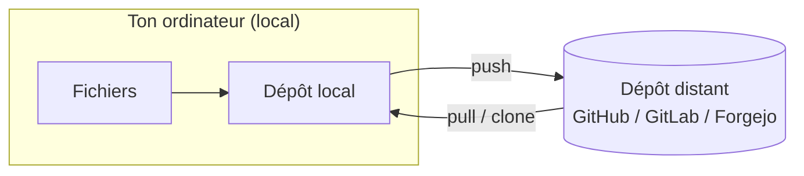

# 1. Git et les dépôts

## Git, c'est quoi ?
Un outil qui **enregistre l'historique** de ton projet : chaque modification validée est un *commit* (une photo du projet à un instant donné).

| Besoin | Ce que Git apporte | Exemple |
|--------|--------------------|---------|
| Versionner | Chaque version est conservée | Retrouver le code d'il y a 2 semaines |
| Checkpoint | Point de sauvegarde avant un test risqué | « Ça marchait au commit `a3f9c1` » |
| Suivre / monitorer | Qui a changé quoi, quand, pourquoi | `git log`, `git blame` |
| Partager | Tout le monde récupère le même code | Un collègue clone ton projet |
| Travailler à plusieurs | Chacun sa branche, puis on fusionne | Deux personnes, deux fonctionnalités |
| Annuler | Revenir en arrière sans rien perdre | `git revert` |

## Local vs distant

- **Local** : sur ta machine, fonctionne hors-ligne.
- **Distant** (`origin`) : copie hébergée sur un serveur, point commun de l'équipe, sauvegarde.

## Plateformes d'hébergement

| | GitHub | GitLab | Forgejo |
|---|---|---|---|
| Hébergement | Cloud (Microsoft) | Cloud ou auto-hébergé | Auto-hébergé (open source) |
| Point fort | Le plus répandu, communauté, Actions (CI) | Tout-en-un DevOps, CI/CD intégrée | Léger, libre, souverain |
| Vocabulaire | Pull Request | Merge Request | Pull Request |
| Idéal pour | Open source, portfolio | Entreprises, contrôle des données | Hébergement perso / associatif |

> Git est le même partout : seul l'hébergeur change.
