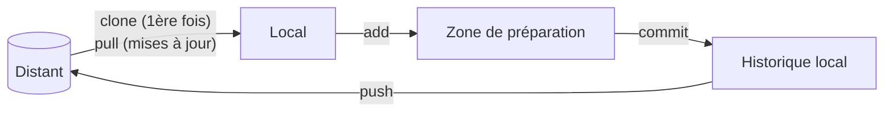

# 2. Commandes de base

## Le cycle complet



## Distant → local

| Commande | Rôle |
|----------|------|
| `git clone <url>` | Copier un dépôt distant pour la première fois |
| `git pull` | Récupérer les nouveautés du distant |
| `git status` | Voir l'état de ton dossier (à lancer souvent) |

## Local → distant

| Commande | Rôle |
|----------|------|
| `git add <fichier>` ou `git add .` | Préparer les modifications à enregistrer |
| `git commit -m "feat: ajoute la page login"` | Enregistrer (voir [04-commits.md](04-commits.md)) |
| `git push` | Envoyer les commits vers le distant |

```bash
git pull                      # 1. se mettre à jour
# ... tu modifies des fichiers ...
git add .                     # 2. préparer
git commit -m "fix: corrige le calcul"   # 3. enregistrer
git push                      # 4. partager
```

## Branches

| Commande | Rôle |
|----------|------|
| `git branch` | Lister les branches |
| `git branch feat/login` | Créer une branche |
| `git switch feat/login` | Aller sur une branche (ancien : `git checkout`) |
| `git switch -c feat/login` | Créer **et** aller dessus |
| `git merge feat/login` | Fusionner `feat/login` dans la branche courante |

```bash
git switch main
git merge feat/login          # intègre feat/login dans main
```
