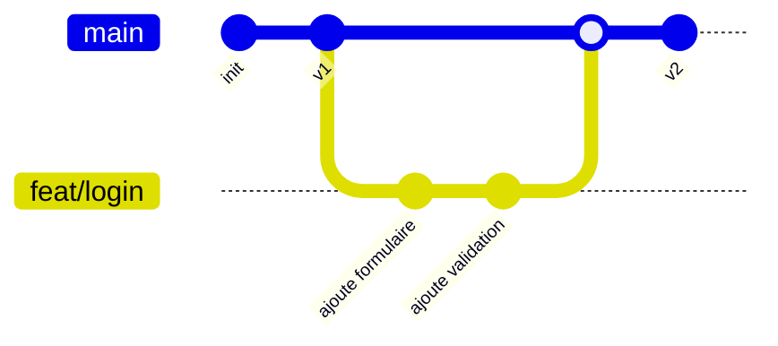
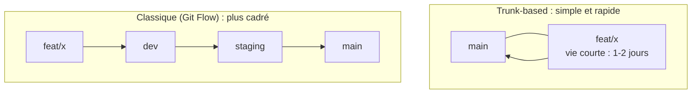

# 3. Les branches

## C'est quoi ?
Une **ligne de développement parallèle**. Tu travailles dans ta branche sans casser `main`, puis tu fusionnes (*merge*).

## Branches principales

| Branche | Rôle | Stabilité |
|---------|------|-----------|
| `main` | Code officiel, prêt à être utilisé | Très stable |
| `staging` | Pré-production : on teste avant de livrer | Stable |
| `dev` | Intégration du travail en cours | Peut être instable |

## Nommage : Conventional Branch (simplifié)

Format : **`type/description-courte`** en minuscules, mots séparés par `-`.

| Préfixe | Usage | Exemple |
|---------|-------|---------|
| `feat/` | Nouvelle fonctionnalité | `feat/page-login` |
| `fix/` | Correction de bug | `fix/calcul-total` |
| `docs/` | Documentation | `docs/readme-install` |
| `refactor/` | Réorganisation du code | `refactor/api-routes` |
| `chore/` | Maintenance, config | `chore/maj-dependances` |

Règles : minuscules, pas d'espaces, court et explicite, pas de caractères spéciaux.

## Deux façons de s'organiser

| | Trunk-based | Classique (dev / staging / main) |
|---|---|---|
| Principe | Tout le monde intègre vite dans `main` | Les changements montent par étapes |
| Branches | `main` + branches très courtes | `feat/*` → `dev` → `staging` → `main` |
| Livraison | Fréquente, continue | Par versions planifiées |
| Demande | Bons tests automatiques | Plus de discipline et de merges |
| Adapté à | Petites équipes, déploiement continu | Gros projets, validation par étapes |

> Débutant : commence par `main` + une branche `feat/` par tâche, c'est déjà du trunk-based.
