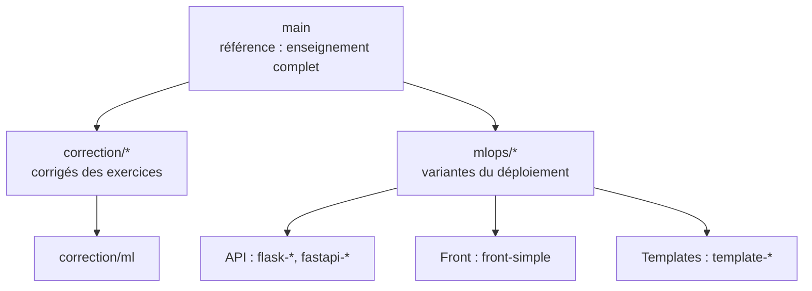

# 5. Les branches de ce repo

Ce repo ne suit pas le schéma classique (`feat/` → `dev` → `main`). Ses branches **divergent volontairement** : chacune a pour but de **transmettre un contenu pédagogique organisé**, pas de converger vers un seul `main`.

## Les familles de branches

| Branche | Rôle |
|---------|------|
| `main` | Branche principale : l'ensemble de **référence**, la version la plus complète de l'enseignement |
| `correction/*` | **Corrections** des exercices d'une section (ex : `correction/ml` pour les exercices de ML) |
| `mlops/*` | Une **variante différente** de la partie déploiement par branche |

## Pourquoi `mlops/*` ?

Sur `main`, le dossier `model-deployment` est **vide** (ou ne contient qu'un README) : ce README explique comment fonctionnent les branches `mlops/*`.

Chaque branche contient une variante complète, ce qui permet de s'y retrouver facilement entre :

| Type de variante | Exemples de branches |
|------------------|----------------------|
| Variantes d'API | `mlops/flask-simple`, `mlops/flask-avance`, `mlops/flask-avance-uv-docker`, `mlops/fastapi-simple`, `mlops/fastapi-avance` |
| Variantes de front | `mlops/front-simple` |
| Templates | `mlops/template-api`, `mlops/template-front`, `mlops/template-full` (et leurs versions `-render`) |

> Évolution possible : la version `template-full` pourrait être placée sur `main`. Réflexion en cours.

## À retenir

- On **ne fusionne pas** les branches `mlops/*` entre elles ni dans `main` : ce sont des variantes parallèles.
- Pour changer de variante : `git switch mlops/fastapi-simple`.
- Les noms suivent `famille/variante` (cf. [03-branches.md](03-branches.md)).
